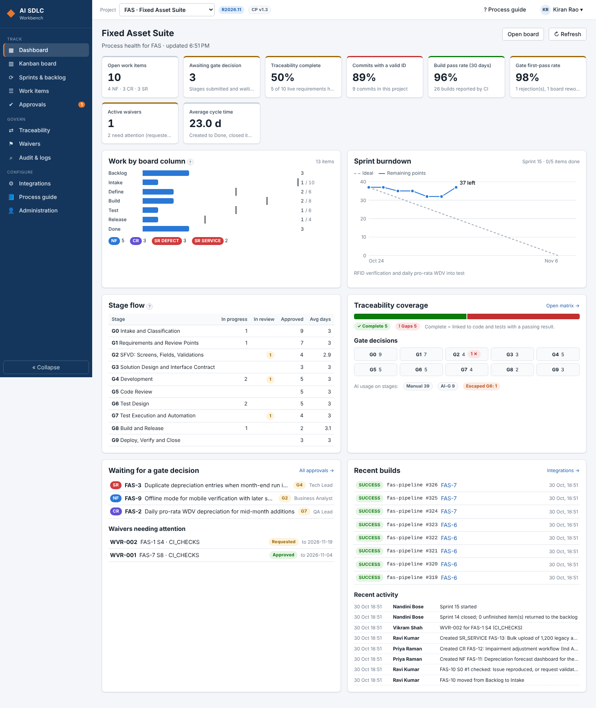
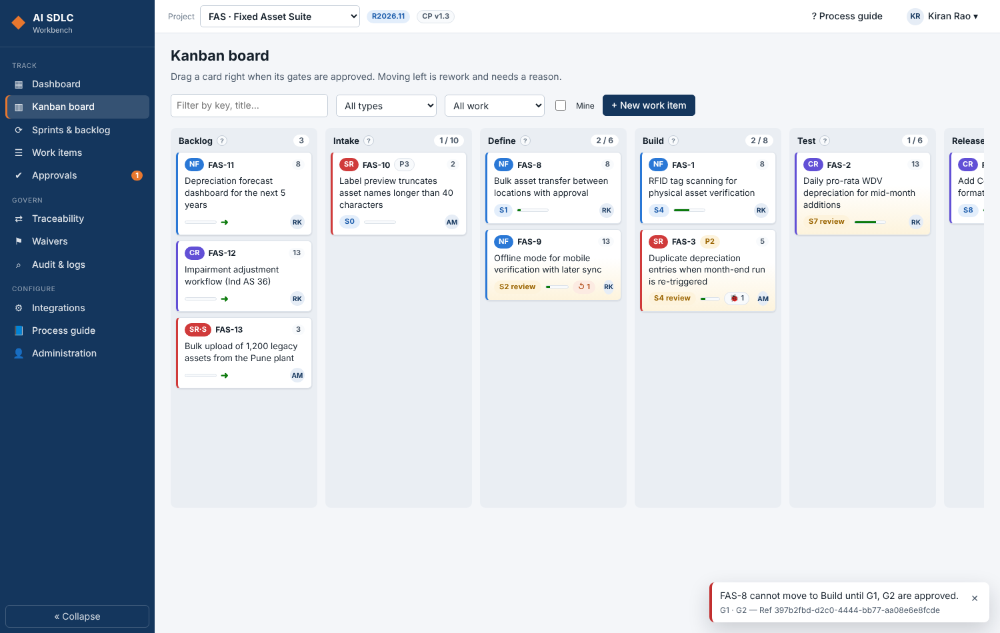
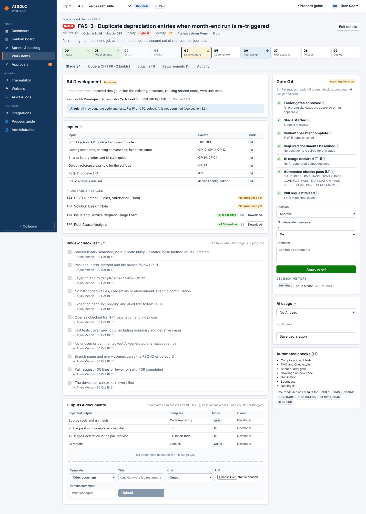
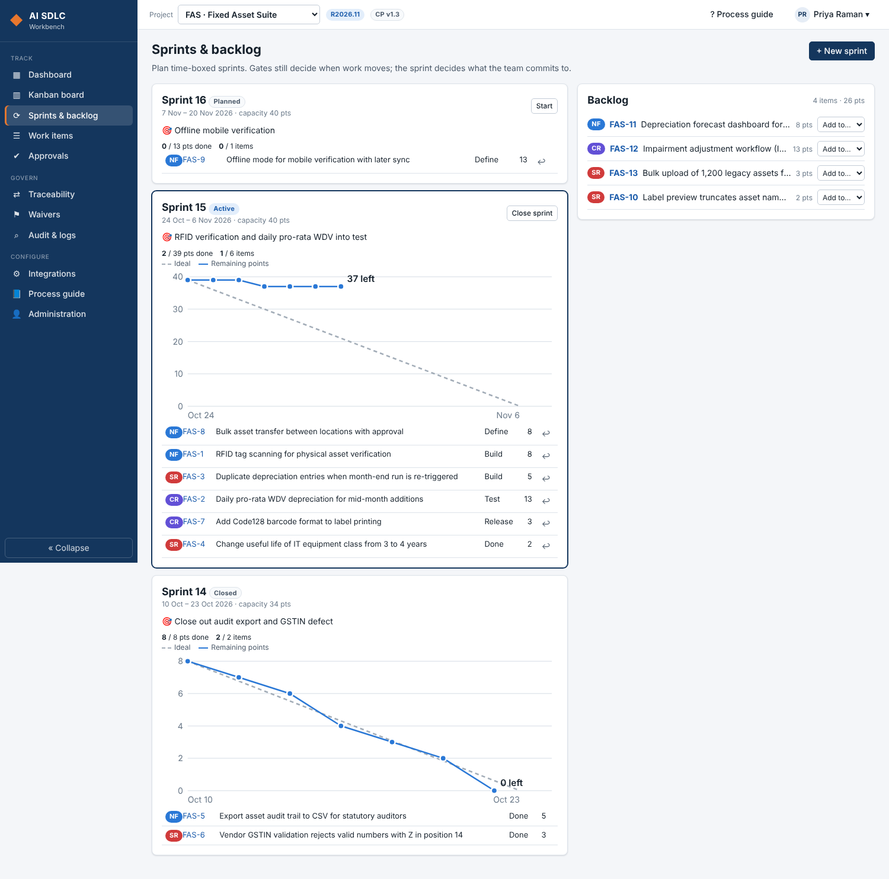

# AI SDLC Workbench

A project management application that runs the AI SDLC process defined in `../ai-sdlc-process`
(PD-AISDLC-01): ten stages (S0–S9), ten gates (G0–G9), stage checklists, AI usage declarations,
versioned input and output documents, waivers, a Kanban board and sprints, a requirement
traceability matrix, and integrations with Git, Jenkins and Bugzilla.

| Layer    | Technology |
|----------|------------|
| Frontend | Angular 21 (standalone components, signals, zoneless), Angular CDK drag-and-drop |
| Backend  | Java 21, Spring Boot 4.1 REST API, Spring Security (JWT), method security |
| Database | MongoDB (NoSQL); document files in GridFS |
| Integrations | GitHub / GitLab / Bitbucket webhooks, Jenkins, Bugzilla 5 REST API |

## What it covers

| Need | Where |
|------|-------|
| Every process step | Work item page: stage stepper S0–S9 with purpose, inputs, activities, outputs, AI rule and RACI from the process definition |
| Checklist updates | Per-stage review checklist; each tick records who and when |
| Approval process and gatekeeping | Gate panel evaluates 7 conditions (prerequisites, stage started, checklist, baselined documents, AI declaration, Jenkins checks, PR evidence). Only the accountable role can decide; the person who ran the AI prompt can neither sign nor act as L3 reviewer. Rejection sends the stage back with a reason and counts as rework. |
| Input and output documents with versions | Upload adds 0.1, 0.2 …; baseline creates 1.0, 2.0 …; SHA-256 per version; earlier stages' outputs appear as inputs to later stages; approved stages freeze their outputs |
| Agile / Kanban | Board columns Backlog → Intake → Define → Build → Test → Release → Done. A card can only move right when the gates of the earlier columns are approved; WIP limits; moving left needs a reason. Sprints with capacity, backlog planning and burndown. |
| Traceability matrix | REQ-ID → SFVD → work items → commits/PRs → test cases → last result → release; coverage status; CSV export. Git and Jenkins fill it automatically. |
| Source control | Webhooks link commits and pull requests to work items and requirements by the keys in messages, branches and PR titles; ID-discipline metric |
| DevOps | Jenkins posts build and check results (G4–G9 read them) and asks `gate-check` before promoting |
| Bugzilla | Link bugs, raise a bug from an SR defect, import open bugs as SR defects, 15-minute status sync, resolve as FIXED when G9 is approved |
| Exceptions | Waivers: time-boxed (≤ 90 days), risk-rated, with compensating controls; decided by the Council or Architect, never by the requester; expire automatically |
| Audit log | Append-only record of every action with actor, time and correlation ID; filter, page and export CSV |
| Exception handling and logging | RFC 7807 problem responses with a correlation ID shown to the user; unexpected errors stored in the system log; rolling log files (`logs/ai-sdlc-pm.log`) with correlation ID and user in every line |
| Dashboard | KPIs (open work, waiting approvals, traceability, ID discipline, build pass rate, gate first-pass rate, waivers, cycle time), work per column against WIP limits, burndown, stage flow, gate decisions, AI usage, escaped defects, recent builds and activity |

## Run it locally (no MongoDB needed)

The `dev` profile starts an in-process MongoDB-compatible server and loads a demo project
(Fixed Asset Suite: RFID verification, daily pro-rata WDV, duplicate depreciation defect, and more).

```bash
# terminal 1 — API on :8080 (data kept in backend/data/; delete the folder to re-seed)
cd backend && mvn spring-boot:run -Dspring-boot.run.profiles=dev

# terminal 2 — UI on :4200 (proxies /api to :8080)
cd frontend && npm install && npm start
```

Open http://localhost:4200 and sign in. Every demo user has the password `Demo@2026`:

| User | Roles | Try |
|------|-------|-----|
| `admin` | Administrator | everything |
| `ravi.ba` | Business Analyst | S0/S1 work, submit gates |
| `priya.po` | Product Owner | approve or reject G1 |
| `anita.arch` | Architect, AI Governance Council | G3, decide waivers |
| `kiran.tl` | Tech Lead | G4/G5 approvals, mark stages not applicable |
| `dev.arjun`, `dev.meera` | Developer | S4 |
| `lakshmi.qa` / `vikram.qe` | QA Lead / QA Engineer | G6/G7 |
| `suresh.rm`, `deepa.ops`, `nandini.dm` | Release Manager, DevOps, Delivery Manager | G8/G9, sprints |

## Run with Docker

```bash
APP_JWT_SECRET=$(openssl rand -base64 48) docker compose up -d --build
# UI: http://localhost:8081   (set APP_SEED=false for an empty system with only users you create)
```

## Configuration (environment variables)

| Variable | Default | Purpose |
|----------|---------|---------|
| `MONGODB_URI` | `mongodb://localhost:27017/aisdlc` | MongoDB connection |
| `APP_JWT_SECRET` | development value | HS256 signing key, 32+ characters. **Change it.** |
| `APP_PUBLIC_URL` | `http://localhost:8080` | Base URL shown for webhook endpoints |
| `APP_CORS_ORIGINS` | `http://localhost:4200` | Allowed browser origins |
| `APP_SEED` | `false` (`true` in dev) | Load the demo project when the database is empty |
| `APP_MONGO_EMBEDDED` | `false` (`true` in dev) | Use the in-process server instead of MongoDB |
| `APP_BUGZILLA_SYNC_CRON` | `0 */15 * * * *` | Bugzilla status sync schedule |
| `LOG_DIR` | `logs` | Rolling log files |

## Brand colours

All colours are in one file: `frontend/src/styles/brand.scss`. The SmartAssets site
(www.levantare.co.in/smartassets) could not be reached from the build environment, so the
`--brand-*` values are placeholders. Put the site's hex codes there; nothing else needs to change.
The chart series colours in the same file are checked for colour-blind separation.

## Tests

```bash
cd backend && mvn test        # 14 tests: webhook parsing, Bugzilla client and G9 resolution, end-to-end API flow on seeded data
cd frontend && npx ng build   # strict template type checking
```

## Layout

```
backend/   Spring Boot API (package com.aisdlc.pm: workitem, gate, document, waiver, trace, sprint, dashboard,
           integration/{git,ci,bugzilla}, audit, user, project, process, seed, common, config)
frontend/  Angular app (core/ services and models, layout/ shell, pages/ one file per screen)
tools/     export-process.js — regenerates the process definition and templates from ../ai-sdlc-process
docs/      integrations.md (Git, Jenkins, Bugzilla set-up), api.md (endpoint reference)
```

The process definition the gates enforce is generated from the same source as the Word document:
after changing `../ai-sdlc-process/build/process_data.js`, run
`node tools/export-process.js` and restart the API.

## Screenshots

| | |
|---|---|
|  |  |
|  |  |
